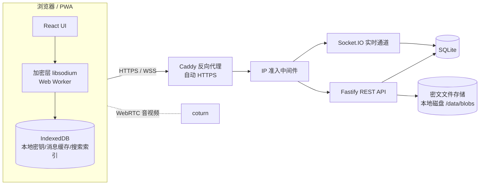
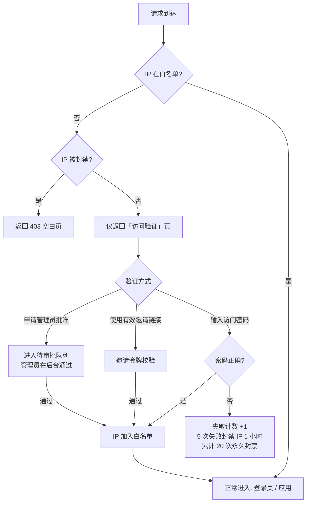

# 加密隐私聊天（Web 版）开发文档

> 版本：v0.2 · 日期：2026-09-26 · 作者：MingYAN（v0.2：M0–M2 已实现，见第 20 节）
> 定位：类 Telegram 的私人加密聊天网页应用，小圈子自建（≤ 50 人），单台 VPS + Docker 部署。

---

## 0. 目录

1. 项目目标与范围
2. 关键决策（已确认）
3. 总体架构
4. 访问控制：IP 准入 + 访问密码
5. 账号体系与登录
6. 端到端加密（E2EE）设计
7. 功能清单
8. 删除机制（含单方面删除）
9. 邀请机制（多种方式）
10. 数据模型（数据库表）
11. 接口设计（REST + WebSocket）
12. 前端设计
13. 安全加固清单
14. 目录结构
15. 部署与运维
16. 测试策略
17. 开发里程碑
18. 已知限制与风险
19. 附录：术语
20. 实现记录（与设计的差异）

---

## 1. 项目目标与范围

### 1.1 目标
- 浏览器即可使用，体验接近 Telegram Web（会话列表 + 聊天窗口 + 侧栏资料）。
- **两道门**：先过「IP 准入 / 访问密码」，再过「账号登录」。陌生 IP 连登录页都看不到。
- **端到端加密**：消息、文件、图片、语音在浏览器内加密，服务器只保存密文，运营者也无法读取内容。
- 支持**单方面删除**：任一方可只删自己这边，或直接撤回双方的消息/清空双方记录，无需对方同意。
- 支持**多种邀请方式**进入系统和进入群聊。

### 1.2 不在范围（v1）
- 原生 App（可后续用 PWA 覆盖大部分场景）。
- 公开注册、公开频道、机器人平台、联邦互通。
- 大规模横向扩展（架构预留，但 v1 单机）。

---

## 2. 关键决策（已确认）

| 项目 | 决策 |
|---|---|
| 加密级别 | 端到端加密（E2EE），服务器零知识 |
| 技术栈 | 前端 React + Vite + TypeScript；后端 Node.js（Fastify）+ Socket.IO |
| 数据库 | SQLite（WAL 模式，better-sqlite3 + Drizzle ORM），后期可切 PostgreSQL |
| 规模/部署 | 私人小圈子，单 VPS，Docker Compose（app + Caddy + coturn） |
| IP 准入 | 新 IP 须输入访问密码（或管理员批准）；通过后记住该 IP，下次直接进入 |
| 加密库 | libsodium（`libsodium-wrappers-sumo`），前后端同一实现 |

---

## 3. 总体架构



**原则**
- 服务器只做：准入、鉴权、路由密文、存储密文、推送通知（不含内容）。
- 所有加解密在浏览器 Web Worker 中完成，避免阻塞 UI。
- 服务器不可信假设：即使数据库被拖走，也拿不到消息明文和私钥。

---

## 4. 访问控制：IP 准入 + 访问密码

### 4.1 流程



### 4.2 规则
- **白名单外的请求**：除 `/gate/*` 和静态的验证页外，所有路由（含 API、WebSocket、静态资源）一律 403，不暴露应用本身。
- **访问密码**：由管理员在后台设置，Argon2id 哈希存储；可随时更换（更换不影响已记住的 IP）。
- **记住 IP**：白名单条目包含 `ip`、`首次通过时间`、`最后访问时间`、`来源（密码/邀请/审批）`、`备注`、`过期时间（可选，默认 90 天未访问自动失效）`。
- **真实 IP 获取**：只信任 Caddy 传入的 `X-Forwarded-For`（Fastify `trustProxy` 只设为 Caddy 容器地址），防止伪造请求头绕过。
- **IPv6**：按 /64 前缀匹配（同一家庭宽带 IPv6 后缀常变）；IPv4 按完整地址匹配。可在后台切换精度。
- **管理员后台**：查看/删除/备注白名单、查看验证失败日志、处理待审批请求、解除封禁。

### 4.3 与账号的关系
IP 准入只决定「能否看到应用」，不代表身份。通过后仍须账号登录。两者独立，任一失败都无法使用。

### 4.4 注意事项
- 手机 4G/5G、公司网络 IP 经常变化，换 IP 后需重新输入访问密码——这是本设计的预期行为，在验证页给出提示文案。
- 运营商 NAT（CGNAT）下多人共用一个出口 IP，白名单会连带放行同出口的陌生人；账号登录这第二道门就是为此兜底。

---

## 5. 账号体系与登录

### 5.1 注册
- **关闭公开注册**，只能通过邀请注册（见第 9 节）。
- 第一个账号通过服务器命令行初始化为管理员：`docker compose exec app npm run create-admin`。

### 5.2 密码派生（密码不出浏览器）
用户密码在浏览器中派生两把密钥，服务器永远拿不到原始密码：

```
masterKey = Argon2id(password, salt=用户专属盐, ops=3, mem=64MB)   // 浏览器内
authKey   = KDF(masterKey, "auth")     → 发送给服务器用于登录
encKey    = KDF(masterKey, "enc")      → 永不离开浏览器，用于解密私钥备份
服务器存储: Argon2id(authKey, 服务器盐)   // 二次哈希
```

- 登录流程：前端 `GET /auth/salt?username=` → 本地派生 → `POST /auth/login {username, authKey}`。
- 为防止用户名枚举，不存在的用户名也返回一个确定性伪造的盐。
- 可选 **TOTP 两步验证**（兼容 Google Authenticator）。

### 5.3 会话
- 登录成功发放 `HttpOnly + Secure + SameSite=Strict` Cookie（随机 256 位会话 ID，服务端存哈希）。
- 每个会话记录设备名、UA、IP、最后活跃时间；用户可在「设备管理」查看并踢下线任意设备。
- 空闲 30 天自动过期；敏感操作（改密码、导出密钥、删除账号）要求重新输入密码。

### 5.4 改密码
改密码 = 重新派生 `authKey/encKey` → 用新 `encKey` 重新加密私钥备份 → 一次性提交。消息无需重新加密。

---

## 6. 端到端加密（E2EE）设计

### 6.1 密钥体系

| 密钥 | 算法 | 位置 | 用途 |
|---|---|---|---|
| 身份签名密钥 IK_sign | Ed25519 | 私钥：浏览器；公钥：服务器 | 签名自己的公钥、密钥分发包，防篡改 |
| 身份加密密钥 IK_box | X25519 | 同上 | 接收别人发来的会话密钥 |
| 私钥备份 | XChaCha20-Poly1305(encKey) | 服务器（密文） | 换设备/清缓存后恢复私钥 |
| 会话密钥 ChatKey（按纪元 epoch） | 32 字节随机，XChaCha20-Poly1305 | 各成员浏览器；服务器仅存「用成员公钥密封后的副本」 | 加密该聊天内所有消息 |
| 文件密钥 FileKey | 每个文件一把随机密钥 | 放在消息密文里 | 加密附件 |

### 6.2 会话密钥分发
- **创建聊天**：创建者浏览器生成 `ChatKey(epoch=1)`，用每个成员的 `IK_box` 公钥 `crypto_box_seal` 密封，连同 Ed25519 签名上传。服务器只存密封包。
- **加入成员**：新成员进入后，由任一在线的管理员/成员客户端自动**轮换**到新纪元（`epoch+1`），把新密钥密封给所有当前成员。新成员**看不到加入前的历史**（隐私优先，可在群设置里改为「分享历史密钥」）。
- **移除/退出成员**：立即轮换纪元，被移出者拿不到新密钥，无法读取之后的消息。
- 新成员在拿到密钥前，界面显示「等待成员分发密钥…」；分发任务由在线成员客户端的后台 Worker 完成。

### 6.3 消息加密格式
```json
{
  "chatId": "c_...",
  "epoch": 3,
  "senderId": "u_...",
  "nonce": "base64(24B)",
  "ciphertext": "base64(XChaCha20-Poly1305(ChatKey_epoch3, payload, aad=chatId|epoch|senderId|clientMsgId))",
  "signature": "base64(Ed25519(IK_sign_sender, nonce|ciphertext|aad))"
}
```
`payload`（明文，仅浏览器可见）示例：
```json
{ "type": "text", "text": "你好", "replyTo": "m_...", "mentions": ["u_..."], "sentAt": 1790000000000 }
```
- 服务器可见的元数据仅有：chatId、发送者、时间、密文长度、消息序号。消息类型、内容、回复关系、@提及全部在密文内。
- 密文长度按 256 字节分块填充，减少长度泄露。

### 6.4 附件加密
1. 浏览器生成 `FileKey`，用 `crypto_secretstream`（XChaCha20-Poly1305 流式）分块加密文件。
2. 上传密文到 `/blobs`，得到 `blobId`。
3. 把 `{blobId, FileKey, 文件名, MIME, 大小, 缩略图(已加密), 时长}` 放进消息 payload 一起加密。
4. 图片/视频缩略图在本地生成后同样加密。服务器看不到文件名和类型。

### 6.5 身份验证（防服务器中间人）
- 每对联系人可查看「安全码」：双方身份公钥拼接后的哈希，显示为 60 位数字 + 二维码，线下比对。
- 对方身份密钥变更时，聊天中插入醒目的系统提示「对方的安全码已变更」。

### 6.6 多设备
- 同一账号在新设备登录后，用 `encKey` 解密私钥备份即可获得身份私钥，然后从服务器拉取所有「密封给自己的 ChatKey」解开，历史消息即可解密。
- 本地 IndexedDB 中的私钥用一个不可导出的 WebCrypto `CryptoKey` 再包一层，降低被 XSS 直接读走明文的风险。

### 6.7 前向保密说明（取舍）
v1 采用「纪元会话密钥」方案，实现简单、多设备友好，但**前向保密粒度是纪元**而非每条消息。为弥补：
- 每 7 天或每 1000 条消息自动轮换纪元；
- 「阅后即焚」「私密聊天」模式可设置更短轮换周期。
v2 可升级为 MLS（RFC 9420，OpenMLS 编译为 WASM）获得完整前向保密与入侵后恢复能力。

---

## 7. 功能清单

优先级：P0 = 首版必须；P1 = 首版尽量；P2 = 后续迭代。

### 7.1 聊天类型
| 功能 | 优先级 |
|---|---|
| 一对一私聊 | P0 |
| 群组（≤ 200 人，管理员/成员两级角色） | P0 |
| 频道（只有管理员可发言，成员只读） | P2 |
| 收藏夹（给自己发消息） | P1 |

### 7.2 消息
| 功能 | 优先级 |
|---|---|
| 文本、Emoji、换行、链接识别 | P0 |
| 简易 Markdown（粗体/斜体/代码/剧透遮罩） | P1 |
| 回复（引用）、转发（重新用目标聊天密钥加密） | P0 |
| 编辑消息（保留「已编辑」标记） | P0 |
| 删除（见第 8 节） | P0 |
| @提及、表情回应（Reaction） | P1 |
| 置顶消息 | P1 |
| 图片、视频、文件（单文件 ≤ 200MB） | P0 |
| 语音消息（MediaRecorder 录制，Opus） | P1 |
| 贴纸 / GIF（本地贴纸包，不接第三方） | P2 |
| 投票 | P2 |
| 阅后即焚 / 定时自毁（按聊天设置：5 秒～1 周） | P1 |
| 定时发送 | P2 |
| 草稿自动保存 | P1 |
| 链接预览（**默认关闭**，发送方本地抓取，避免泄露 IP 给第三方） | P2 |

### 7.3 状态与通知
| 功能 | 优先级 |
|---|---|
| 送达 / 已读回执（可在隐私设置关闭） | P0 |
| 正在输入提示 | P0 |
| 在线 / 最后上线时间（可隐藏） | P1 |
| 未读计数、@我的提示 | P0 |
| 浏览器桌面通知 & Web Push（推送内容仅「你有新消息」，不含明文） | P1 |
| 聊天静音、置顶、归档 | P1 |

### 7.4 联系人与资料
| 功能 | 优先级 |
|---|---|
| 用户名、昵称、头像（头像也加密，仅联系人可解） | P0 |
| 联系人列表、拉黑 | P0 |
| 个人简介 | P1 |
| 隐私设置（谁能看到在线状态/头像/拉我进群） | P1 |

### 7.5 搜索
- 由于服务器不可读内容，**搜索在浏览器本地进行**：解密后的消息写入 IndexedDB 的本地全文索引（MiniSearch，中文按字 + 二元分词）。
- 支持：全局搜索、聊天内搜索、按类型筛选（图片/文件/链接）。
- P0：聊天列表搜索（按名称）；P1：消息全文搜索。

### 7.6 音视频通话（P2）
- WebRTC 一对一语音/视频通话，信令走 Socket.IO，媒体走 DTLS-SRTP（天然端到端）。
- 自建 coturn 作 TURN 中继，TURN 凭证为短期 HMAC 凭证。
- 群通话后续评估（需 SFU，如 LiveKit）。

### 7.7 其他
- 深色/浅色主题、中英文界面（i18n）。
- PWA：可「添加到主屏幕」，离线可查看已缓存消息。
- 数据导出：导出本人某个聊天的明文记录（本地生成 HTML/JSON，不经过服务器）。
- 注销账号：删除账号、私钥备份、所有本人发送的消息（可选）。

---

## 8. 删除机制（含单方面删除）

「单方面」指**不需要对方同意**。提供以下几种删除，任何一方都有权执行：

| 操作 | 效果 | 实现 |
|---|---|---|
| **仅为我删除**（单条/多选） | 只在自己这边消失，对方仍可见 | `message_hidden(user_id, message_id)`；客户端同时删本地缓存 |
| **为所有人删除 / 撤回**（单条/多选） | 双方都消失，**不限时间**，私聊中可删除对方发的消息（同 Telegram） | 服务器**物理删除密文**并留一条墓碑（`id, chat_id, deleted_at`，无内容）；通过 WebSocket 通知所有成员客户端删除本地缓存与索引；附件 blob 同步删除 |
| **清空我的聊天记录** | 只清自己这边的全部历史 | 为该成员记录 `cleared_before_seq`，服务器之后不再向其返回此序号之前的消息 |
| **清空双方聊天记录**（仅私聊） | 双方所有历史全部物理删除 | 删除该聊天所有消息与附件，推送 `chat:cleared` 事件 |
| **删除聊天**（私聊） | 可选「同时为对方删除」 | 勾选则等同于清空双方 + 删除会话；不勾选则仅为我清空并隐藏会话 |
| **群聊中删除** | 普通成员可为所有人删除**自己**的消息；管理员可删除任何人的消息 | 同上 |
| **阅后即焚** | 对方已读后 N 秒自动为双方删除 | 客户端计时 + 服务器按 `expires_at` 定时任务兜底物理删除 |

**设计要点**
- 是否显示「此消息已被删除」占位由设置决定，默认**不留痕迹**（Telegram 风格）。
- 「为所有人删除」是服务器强制执行的：即使对方离线，其下次上线同步时也会收到删除事件。
- 诚实提示（在 UI 的帮助说明中写明）：删除无法阻止对方在删除前截图、拍照或用篡改过的客户端另存。
- 群管理员可在群设置里禁止「清空双方记录」类操作（仅限群；私聊中双方永远有此权利）。

---

## 9. 邀请机制（多种方式）

邀请分两类：**加入系统**（新人注册）和**加入聊天**（已有用户进群/加好友）。

### 9.1 加入系统（注册邀请）
| 方式 | 说明 |
|---|---|
| **邀请链接** | `https://域名/i/<token>`，可设有效期（1 小时～永久）、可用次数（1 次～不限）、是否需管理员审批；打开时该链接同时充当 **IP 通行证**：持有效链接的新 IP 可直接进入注册页并被加入白名单 |
| **邀请码** | 8 位易读短码（排除 0/O/1/l），适合口头/短信告知；在验证页输入「访问密码」或「邀请码」任一均可 |
| **二维码** | 邀请链接生成二维码，面对面扫码 |
| **管理员直接创建** | 管理员后台预创建账号，生成一次性「激活链接」发给对方，对方首次打开设置密码 |

权限：默认仅管理员可生成注册邀请；管理员可开启「普通用户也可邀请（每人上限 N 个）」。每个邀请记录创建者，便于追溯「谁邀请了谁」。

### 9.2 加入聊天（好友/群）
| 方式 | 说明 |
|---|---|
| **按用户名搜索添加** | 输入完整用户名（不支持模糊枚举）发起私聊 |
| **个人名片链接 / 二维码** | `https://域名/u/<username>`，扫码即加 |
| **群邀请链接** | `https://域名/g/<token>`，可设有效期、次数、是否需审批；可随时撤销 |
| **群二维码** | 由群邀请链接生成 |
| **成员直接拉人** | 从联系人列表多选拉入（受对方隐私设置「谁能拉我进群」约束） |
| **申请加群** | 使用需审批的链接，管理员在群内收到申请，同意/拒绝 |

### 9.3 邀请与加密的衔接
- 邀请 token 为 32 字节随机数，服务器只存其 SHA-256，链接泄露后可在后台一键撤销。
- 新人进群后状态为「待分发密钥」，由在线成员客户端自动轮换纪元并分发（见 6.2），通常 1 秒内完成。
- 若链接的 `#` 片段中附带「邀请人公钥指纹」，新人客户端会自动校验邀请人身份，防止服务器替换。

---

## 10. 数据模型（数据库表）

> SQLite，所有 ID 为带前缀的 ULID（如 `u_01J...`），时间为毫秒时间戳。

```sql
-- 访问控制
ip_allowlist(id, ip_or_prefix, source['password'|'invite'|'approval'|'admin'],
             note, created_at, last_seen_at, expires_at)
ip_blocklist(ip, reason, fail_count, blocked_until)            -- blocked_until NULL = 永久
gate_attempts(id, ip, success, method, user_agent, created_at)
gate_requests(id, ip, message, status['pending'|'approved'|'rejected'], created_at)
settings(key, value)                                           -- 访问密码哈希、全局开关等

-- 账号
users(id, username UNIQUE, display_name, auth_salt, auth_hash, totp_secret_enc,
      is_admin, avatar_blob_id, bio, invited_by, created_at, disabled_at)
user_keys(user_id, ik_sign_pub, ik_box_pub, key_backup_ct, key_backup_nonce,
          key_version, updated_at)
sessions(id_hash, user_id, device_name, user_agent, ip, created_at, last_seen_at, expires_at)
privacy_settings(user_id, last_seen['all'|'contacts'|'nobody'], read_receipts,
                 who_can_add_to_group, ...)
contacts(user_id, contact_id, alias, created_at)
blocks(user_id, blocked_id, created_at)

-- 聊天
chats(id, type['direct'|'group'|'channel'|'saved'], title_ct, avatar_blob_id,
      created_by, current_epoch, disappearing_seconds, created_at)
chat_members(chat_id, user_id, role['owner'|'admin'|'member'], joined_at,
             joined_epoch, cleared_before_seq, muted_until, pinned, archived,
             last_read_seq, last_delivered_seq)
chat_keys(chat_id, epoch, recipient_id, sealed_key, distributor_id, signature, created_at)
messages(id, chat_id, seq, sender_id, epoch, nonce, ciphertext, signature,
         edited_at, expires_at, created_at)                    -- seq 每个 chat 内自增
message_tombstones(id, chat_id, seq, deleted_at)
message_hidden(user_id, message_id)                            -- 仅为我删除
pinned_messages(chat_id, message_id, pinned_by, created_at)
blobs(id, owner_id, size, chat_id, created_at)                 -- 文件本体在磁盘 /data/blobs/<id>

-- 邀请
invites(id, token_hash, code, kind['register'|'group'|'contact'], chat_id,
        created_by, max_uses, used_count, needs_approval, expires_at, revoked_at, created_at)
invite_uses(invite_id, user_id, ip, used_at)
join_requests(id, chat_id, user_id, invite_id, status, created_at)

-- 推送
push_subscriptions(id, user_id, session_id, endpoint, p256dh, auth, created_at)
```

**索引**：`messages(chat_id, seq)`、`chat_members(user_id)`、`chat_keys(recipient_id, chat_id)`、`ip_allowlist(ip_or_prefix)`、`messages(expires_at)`。

> 注：群标题 `title_ct` 也用 ChatKey 加密；Reaction、编辑内容作为「引用原消息的新密文消息」发送，服务器无法区分类型。

---

## 11. 接口设计

### 11.1 REST（前缀 `/api`，JSON）

**准入（不需白名单）**
| 方法 | 路径 | 说明 |
|---|---|---|
| GET | `/gate/status` | 当前 IP 是否已放行 |
| POST | `/gate/password` | `{password}` 验证访问密码 |
| POST | `/gate/invite` | `{tokenOrCode}` 用邀请放行 |
| POST | `/gate/request` | `{message}` 申请管理员批准 |

**认证**
| 方法 | 路径 | 说明 |
|---|---|---|
| GET | `/auth/salt?username=` | 取派生盐 |
| POST | `/auth/register` | `{inviteToken, username, authKey, authSalt, pubKeys, keyBackup}` |
| POST | `/auth/login` | `{username, authKey, totp?}` |
| POST | `/auth/logout` | |
| POST | `/auth/change-password` | |
| GET/DELETE | `/auth/sessions[/:id]` | 设备管理 |

**用户/联系人**：`GET /me`、`PATCH /me`、`GET /users/:username`、`GET /users/:id/keys`、`POST/DELETE /contacts/:id`、`POST/DELETE /blocks/:id`、`PATCH /me/privacy`

**聊天**
| 方法 | 路径 | 说明 |
|---|---|---|
| GET | `/chats` | 会话列表（含未读数、最后一条消息密文） |
| POST | `/chats` | 创建私聊/群聊（附带初始密封密钥） |
| PATCH | `/chats/:id` | 改标题/头像/自毁时长 |
| DELETE | `/chats/:id?forEveryone=1` | 删除聊天 |
| POST | `/chats/:id/clear` | `{scope:'me'|'everyone'}` 清空记录 |
| GET | `/chats/:id/messages?before=seq&limit=50` | 拉历史 |
| GET/POST | `/chats/:id/keys` | 拉取/上传密封的纪元密钥 |
| POST/DELETE | `/chats/:id/members[/:uid]` | 拉人/踢人/退群 |
| PATCH | `/chats/:id/members/:uid` | 改角色 |
| POST | `/chats/:id/invites` | 生成群邀请 |
| POST | `/chats/:id/pins` | 置顶消息 |

**附件**：`POST /blobs`（分块上传，≤ 200MB）、`GET /blobs/:id`（仅聊天成员可下载）

**邀请**：`GET /invites/:token`（预览：群名需客户端解密，此处仅返回人数）、`POST /invites/:token/accept`、`DELETE /invites/:id`

**管理后台 `/admin/*`**（仅管理员）：白名单增删改、封禁列表、准入日志、待审批请求、访问密码设置、用户管理（禁用/重置）、注册邀请管理、存储占用统计。

### 11.2 WebSocket 事件（Socket.IO，连接需白名单 IP + 有效会话 Cookie）

客户端 → 服务器
| 事件 | 载荷 |
|---|---|
| `msg:send` | `{chatId, clientMsgId, epoch, nonce, ciphertext, signature, expiresIn?}` → ack `{id, seq, createdAt}` |
| `msg:edit` | `{messageId, nonce, ciphertext, signature}` |
| `msg:delete` | `{messageIds[], scope:'me'|'everyone'}` |
| `msg:read` | `{chatId, seq}` |
| `typing` | `{chatId, state}` |
| `key:distribute` | `{chatId, epoch, sealedKeys:[{recipientId, sealedKey, signature}]}` |
| `call:signal` | `{to, type:'offer'|'answer'|'ice'|'hangup', data}` |

服务器 → 客户端
| 事件 | 说明 |
|---|---|
| `msg:new` / `msg:edited` / `msg:deleted` | 消息变化 |
| `chat:cleared` / `chat:deleted` / `chat:updated` | 聊天变化 |
| `member:joined` / `member:left` | 成员变化 |
| `key:needed` | 有新成员待分发密钥，请在线成员处理 |
| `key:rotated` | 新纪元密钥已就绪 |
| `receipt` / `typing` / `presence` | 状态 |
| `session:revoked` | 当前设备被踢下线 |
| `call:signal` | 通话信令 |

**同步机制**：每个聊天有单调递增 `seq`。客户端重连时发送各聊天 `lastSeq`，服务器补发缺失消息与删除墓碑，保证离线期间的删除也能同步。

---

## 12. 前端设计

### 12.1 技术选型
- React 18 + TypeScript + Vite；路由 React Router；状态 Zustand；
- 样式 Tailwind CSS；虚拟列表 `@tanstack/react-virtual`（长聊天记录）；
- 加密 `libsodium-wrappers-sumo` 运行在 Web Worker（Comlink 封装）；
- 本地存储 Dexie（IndexedDB）；本地搜索 MiniSearch；
- 二维码 `qrcode`；i18n `i18next`；PWA `vite-plugin-pwa`。

### 12.2 页面
1. **访问验证页**（极简，无品牌信息）：访问密码 / 邀请码 输入框 + 「申请批准」。
2. **登录 / 注册页**。
3. **主界面**（三栏，窄屏自动切换为单栏）：
   - 左：会话列表（搜索、置顶、归档、未读徽标、新建聊天按钮）；
   - 中：聊天窗口（消息气泡、日期分隔、右键/长按菜单：回复/转发/编辑/复制/置顶/删除/多选）；
   - 右：聊天资料（成员、共享媒体、邀请链接、安全码、自毁设置）。
4. **设置**：个人资料、隐私、设备管理、通知、外观、数据导出、两步验证。
5. **管理后台**：白名单、日志、审批、用户、邀请、系统设置。

### 12.3 删除交互
点击「删除」弹出对话框：
```
删除这条消息？
[✓] 同时为 张三 删除
        [取消]  [删除]
```
私聊「删除聊天」、「清空历史」同样带「同时为对方删除」勾选框。

---

## 13. 安全加固清单

- [ ] 全站 HTTPS（Caddy 自动证书），HSTS preload。
- [ ] 严格 CSP：`default-src 'self'; script-src 'self' 'wasm-unsafe-eval'; connect-src 'self' wss:; img-src 'self' blob: data:; object-src 'none'; frame-ancestors 'none'`，**不引入任何第三方 CDN、统计、字体**。
- [ ] 消息渲染只走 React 文本节点；Markdown 使用白名单解析器，禁止原始 HTML。
- [ ] Cookie：`HttpOnly; Secure; SameSite=Strict`；所有写操作额外校验 `Origin` 头。
- [ ] 速率限制：准入 5 次/10 分钟/IP；登录 10 次/小时/账号；发消息 30 条/10 秒/用户；上传 1GB/天/用户。
- [ ] 所有密码/令牌比较使用常量时间比较。
- [ ] 日志中不记录任何密文、令牌、Cookie；IP 日志保留 30 天后清理。
- [ ] 上传文件以不可猜测 ID 存储，下载时校验聊天成员身份，响应头 `Content-Type: application/octet-stream` + `Content-Disposition: attachment`。
- [ ] 依赖锁定（`package-lock.json`），CI 跑 `npm audit`；前端构建产物带 SRI 哈希，并在「关于」页公示构建哈希供比对。
- [ ] 数据库文件与 blobs 目录权限 600/700；备份也是密文。
- [ ] 管理后台操作写审计日志。

---

## 14. 目录结构

```
加密隐私聊天/
├── docs/
│   └── 开发文档.md
├── packages/
│   ├── shared/              # 前后端共享：类型定义、协议常量、zod 校验 schema
│   │   └── src/
│   ├── crypto/              # 加密封装（libsodium），前端 Worker 使用，含单元测试
│   │   └── src/{keys,chatKey,message,file,kdf,safetyNumber}.ts
│   ├── server/
│   │   ├── src/
│   │   │   ├── index.ts             # Fastify 启动
│   │   │   ├── gate/                # IP 准入中间件、验证路由
│   │   │   ├── auth/                # 注册登录、会话、TOTP
│   │   │   ├── chats/               # 聊天、成员、消息、删除
│   │   │   ├── keys/                # 密钥分发
│   │   │   ├── invites/
│   │   │   ├── blobs/
│   │   │   ├── admin/
│   │   │   ├── realtime/            # Socket.IO 事件
│   │   │   ├── jobs/                # 定时任务：阅后即焚、过期清理
│   │   │   └── db/{schema.ts,migrations/}
│   │   └── scripts/create-admin.ts
│   └── web/
│       ├── src/
│       │   ├── pages/{Gate,Login,Register,Main,Settings,Admin}/
│       │   ├── components/          # 消息气泡、输入框、会话列表...
│       │   ├── workers/crypto.worker.ts
│       │   ├── store/               # Zustand
│       │   ├── db/                  # Dexie 本地库 + 搜索索引
│       │   ├── realtime/            # Socket.IO 客户端
│       │   └── i18n/
│       └── vite.config.ts
├── deploy/
│   ├── docker-compose.yml
│   ├── Caddyfile
│   └── turnserver.conf
├── Dockerfile
├── package.json            # npm workspaces
└── README.md
```

---

## 15. 部署与运维

### 15.1 服务器要求
1 核 2G 内存 VPS 起步，磁盘按附件量估算；需要一个域名（HTTPS 必需，WebCrypto/Service Worker 要求安全上下文）。

### 15.2 Docker Compose
```yaml
services:
  app:
    build: .
    environment:
      - NODE_ENV=production
      - DATA_DIR=/data
      - PUBLIC_ORIGIN=https://chat.example.com
      - TRUSTED_PROXY=caddy
    volumes: [ "./data:/data" ]
    restart: unless-stopped
  caddy:
    image: caddy:2
    ports: [ "80:80", "443:443" ]
    volumes: [ "./deploy/Caddyfile:/etc/caddy/Caddyfile", "caddy_data:/data" ]
    restart: unless-stopped
  coturn:            # 音视频阶段再启用
    image: coturn/coturn
    network_mode: host
    volumes: [ "./deploy/turnserver.conf:/etc/coturn/turnserver.conf" ]
volumes: { caddy_data: {} }
```

### 15.3 首次启动
```bash
docker compose up -d
docker compose exec app npm run create-admin      # 创建管理员 + 设置访问密码
# 管理员首次访问时，用命令行输出的一次性放行链接把自己的 IP 加入白名单
```

### 15.4 备份
每日 `sqlite3 .backup` + 打包 `/data/blobs`，保留 7 天。备份内容全为密文/哈希，但仍建议加密后异地存放。

### 15.5 应急
- 管理员被锁在门外：服务器执行 `npm run allow-ip -- <ip>`。
- 怀疑泄露：后台一键「清空白名单 + 撤销全部会话 + 更换访问密码」。

---

## 16. 测试策略

| 层级 | 工具 | 重点 |
|---|---|---|
| 加密单元测试 | Vitest | 加解密往返、签名校验失败拒收、纪元轮换后旧成员无法解密、KDF 固定向量 |
| 后端接口测试 | Vitest + Fastify inject | 准入绕过尝试（伪造 X-Forwarded-For）、越权读取他人聊天/附件、删除权限矩阵 |
| 实时事件测试 | socket.io-client | 离线删除同步、重连补发、多设备一致性 |
| 端到端测试 | Playwright | 两个浏览器上下文模拟两人：邀请→注册→私聊→发图→撤回→清空双方记录 |
| 安全检查 | 人工 + ZAP 扫描 | XSS、CSP 生效、数据库内无明文（grep 测试） |

**关键验收用例**：用 `sqlite3` 打开数据库，搜索任意一条已发送消息的明文，必须搜不到。

---

## 17. 开发里程碑

| 阶段 | 内容 | 预估 |
|---|---|---|
| M0 脚手架 | monorepo、Docker、CI、数据库迁移、代码规范 | 2 天 |
| M1 准入 + 账号 | IP 白名单、访问密码、封禁、管理员后台雏形、注册邀请、密码派生登录、会话管理 | 4 天 |
| M2 加密私聊 | 身份密钥、私钥备份、ChatKey 分发、一对一文本收发、已读/输入中、离线同步 | 6 天 |
| M3 群组 + 邀请 | 群聊、角色、纪元轮换、群邀请链接/二维码/审批、用户名添加、名片链接 | 5 天 |
| M4 消息能力 | 回复、转发、编辑、Reaction、置顶、@提及、Markdown | 4 天 |
| M5 删除体系 | 仅我删除、为所有人删除、清空双方、删除聊天、阅后即焚 | 3 天 |
| M6 媒体 | 加密图片/视频/文件/语音、缩略图、媒体浏览 | 5 天 |
| M7 体验 | 本地搜索、通知/Web Push、PWA、主题、i18n、设置页、安全码 | 5 天 |
| M8 加固上线 | 安全清单、E2E 测试、性能、部署文档 | 3 天 |
| M9（可选） | WebRTC 音视频通话、频道、投票、定时发送 | 待定 |

合计首版约 **37 个工作日**（单人全职估算）。

---

## 18. 已知限制与风险

1. **Web 端 E2EE 的根本限制**：前端 JS 由服务器下发，若服务器被攻破并被植入恶意脚本，可在用户下次打开时窃取明文。缓解：严格 CSP、构建哈希公示、PWA 缓存固定版本；终极方案为桌面/移动原生客户端。
2. **IP 准入不是身份认证**：共享出口 IP、代理/VPN 会让白名单变宽，必须配合账号登录。
3. **删除不可验证**：「为所有人删除」依赖对方客户端遵守协议；截图无法阻止。
4. **忘记密码 = 丢失历史**：私钥备份由密码派生的密钥加密，服务器无法帮你找回。注册时提供「恢复码」（24 词助记词，另外派生一份备份密钥）并强制用户确认已保存。
5. **前向保密粒度为纪元**（见 6.7），v2 升级 MLS。
6. **元数据可见**：服务器能看到谁和谁在什么时间通信、消息大小（已填充）。小圈子自建场景下可接受。
7. 请遵守所在地关于加密通信与数据留存的法律法规。

---

## 19. 附录：术语

| 术语 | 含义 |
|---|---|
| E2EE | 端到端加密，只有通信双方能解密 |
| 纪元（Epoch） | 一把会话密钥的生命周期，成员变动或定期时轮换 |
| 密封（seal） | 用对方公钥匿名加密一段数据，只有对方私钥能打开 |
| 墓碑（Tombstone） | 消息被删除后留下的无内容记录，用于同步删除事件 |
| 安全码 | 双方身份公钥的指纹，用于线下核对防中间人 |
| 白名单 IP | 已通过访问验证、被系统记住的 IP |

---

## 20. 实现记录（与设计的差异）

M0–M2（以及 M3、M5 的大部分）已实现。以下是实现时与上文设计不同的地方：

| 项目 | 设计 | 实际实现 | 原因 |
|---|---|---|---|
| ORM | Drizzle | 直接用 better-sqlite3 + 手写迁移（`server/src/db.ts`） | 表结构简单，少一层依赖 |
| authKey 在服务器端的哈希 | Argon2id | 带服务器密钥的 BLAKE2b（keyed generichash） | authKey 已是 Argon2id 派生的 32 字节高熵值，再做一次慢哈希没有意义 |
| 发消息 / 编辑 / 删除 | WebSocket 事件 | REST 接口；WebSocket 只负责推送、输入中、在线状态 | 请求-响应语义更清楚，更好测试；推送仍是实时的 |
| 聊天 ID | 服务器生成 | 客户端生成（`c_` + 随机 12 字节） | 首次密钥分发的签名需要绑定聊天 ID |
| 访问验证 | 密码 / 邀请分两个输入 | 同一个输入框，先按访问密码校验，不对再按邀请码校验 | 用户不用区分两种东西，失败只计一次 |
| 搜索 | 本地全文索引 | 暂时只能按会话名称和用户名过滤 | 放到 M7 |
| 加密计算 | 全部在 Web Worker | Argon2id 在 Worker；消息加解密在主线程 | 单条消息加解密耗时不到 1 毫秒 |
| 群内新成员 | 由在线成员客户端轮换纪元 | 同设计；服务器标记 `needs_rotation`，在轮换完成前拒收新消息（409） | 确保被移出的人拿不到任何新密钥 |

**已知待办**
- 注册时的「恢复码」（第 18 节第 4 条）还没做：目前忘记密码就无法恢复历史。
- 离线期间的删除：客户端没有持久化消息缓存，每次打开都从服务器拉取，所以不存在离线删除不同步的问题；做本地缓存（M7）时需要按墓碑表同步删除。
- Docker 镜像还没有在真实服务器上构建验证过。
